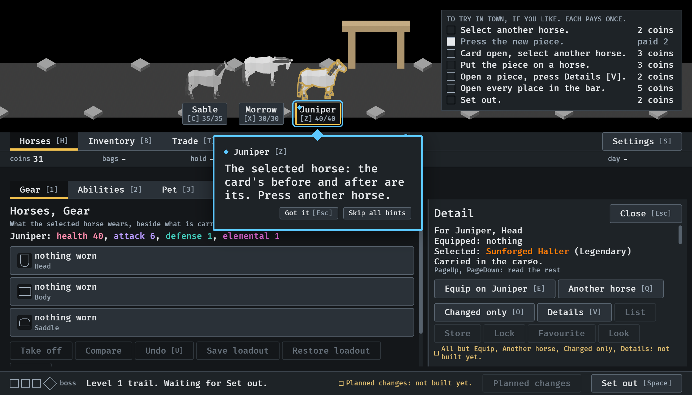
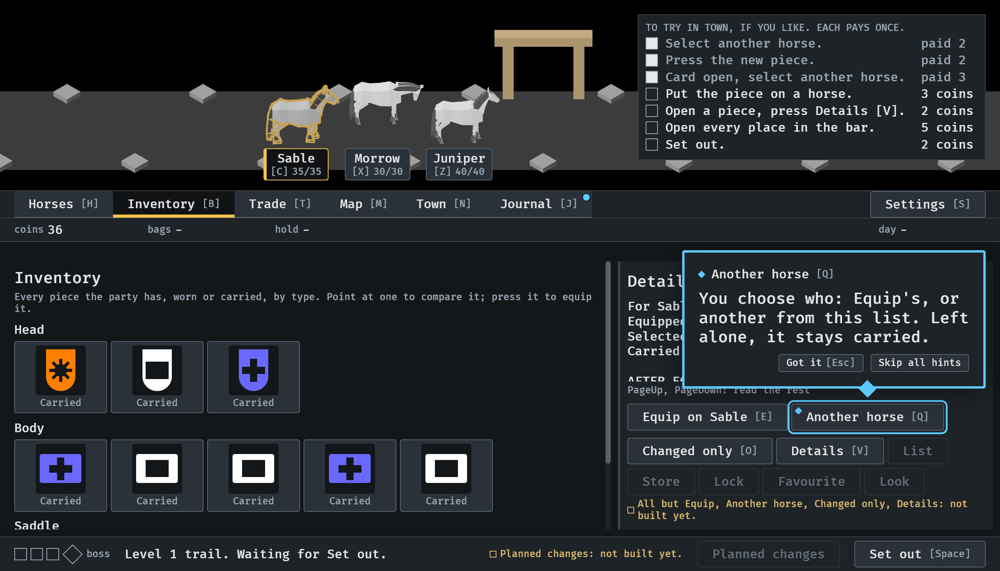

# 2026-10-15, the lessons follow the horses into the scene (#356, part 3)

From the lesson walk (`IDLE_LESSON`), seed 6, at 1120 x 640.

1.  The card's lesson, its mark on the
   selected horse's tag in the scene (Juniper, outlined): "Press another
   horse."
2.  Equip's lesson is on Another horse [Q] now,
   beside "Equip on Sable": who wears it is Equip's horse or one from the
   list it opens; left alone, it stays carried.
