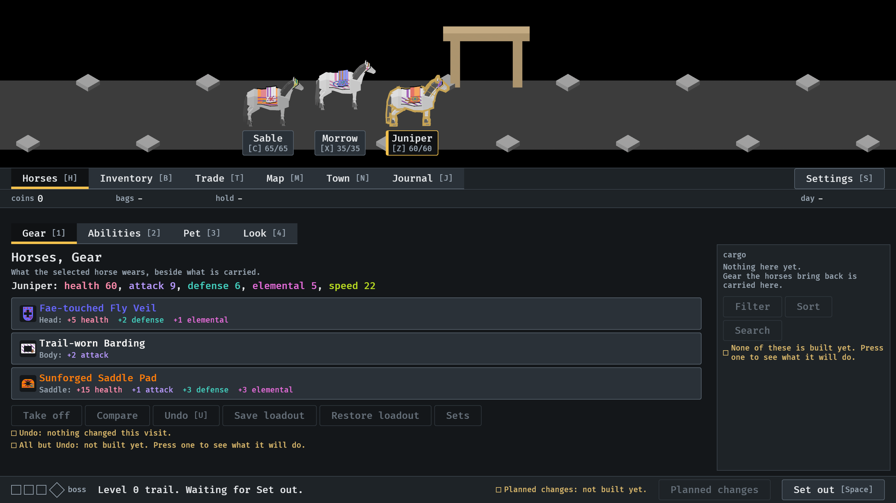
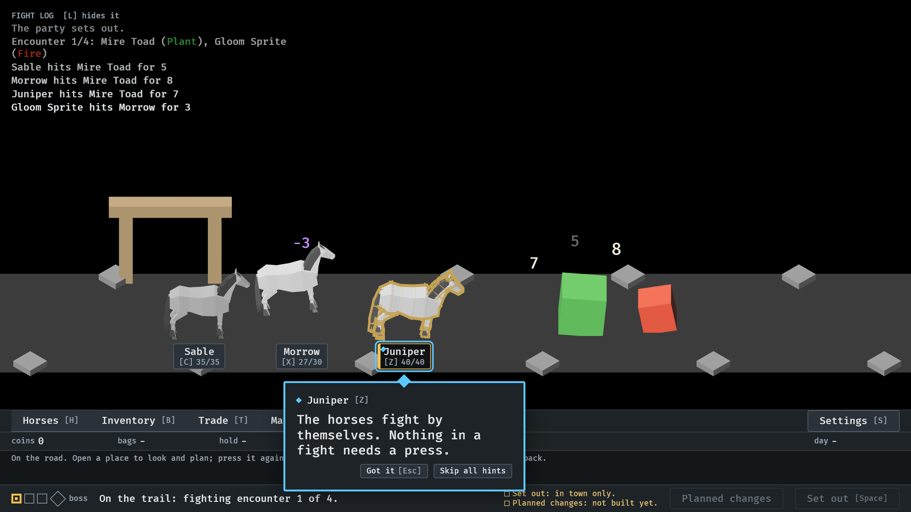

# 2026-10-15, release 0.2.4

From the staged 0.2.4 build, run from another folder.

`--seed 6 --worn --town`, at 3 s: worn gear seen on the horses (#359), each
piece with a look of its own (#361).

`--seed 6 --no-pause`, at 5.72 s: Morrow tips back from a hit (-3), Juniper
tips into hers, the toad tilts from it (#365).
