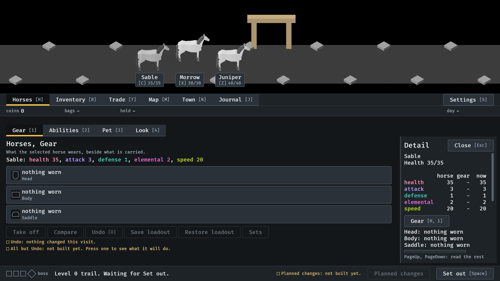
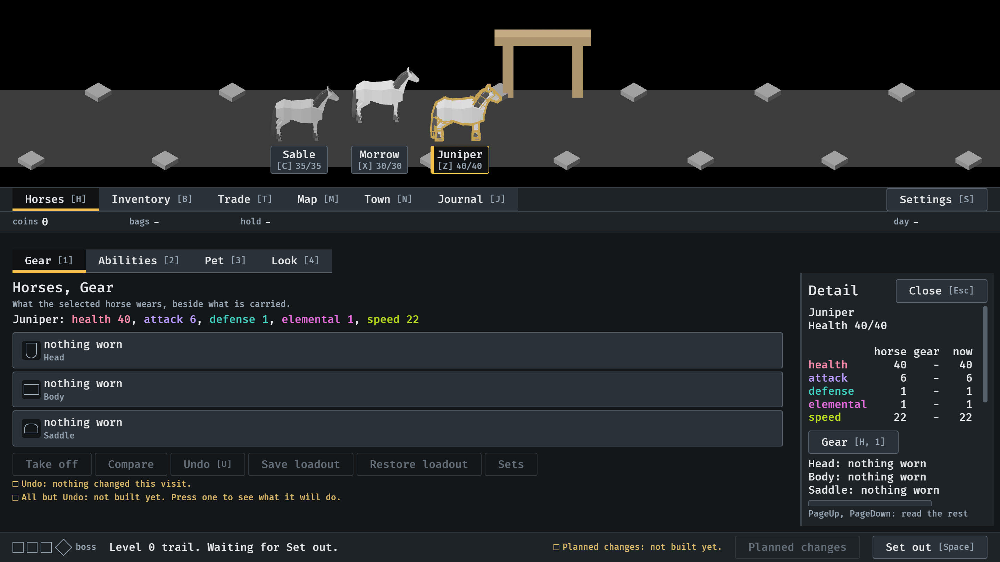
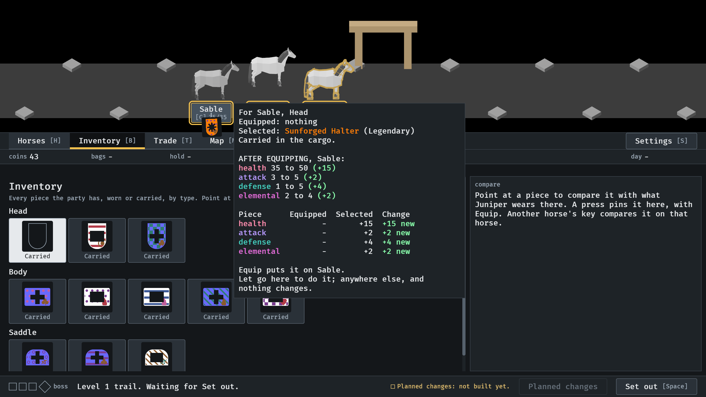
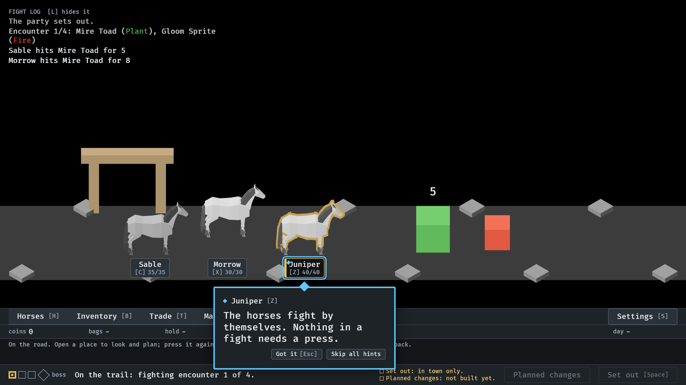
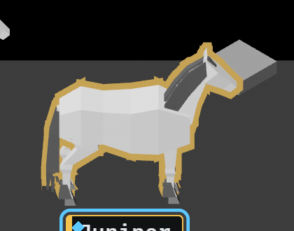

# 2026-10-15, selecting a horse (#366, #367, #368, #369)

1.  In town, after a press on the background: no horse
   is outlined or has its tag lit (#366). The Horses place keeps Sable, the
   last chosen. Menu tour picture 10.
2.  A press on Juniper's tag selects Juniper
   (#367). Menu tour picture 11.
3.  The Sunforged Halter held over Sable's tag:
   the tag lights as the target, and letting go puts it on Sable (#368).
   Menu tour picture 96.
4.  Juniper selected on the road, `--seed 6
   --no-pause` at 5.2 s: one outline round the horse, none where its pieces
   meet (#369).
5.  The same, close. The hooves have no outline,
   where the road hides it.
