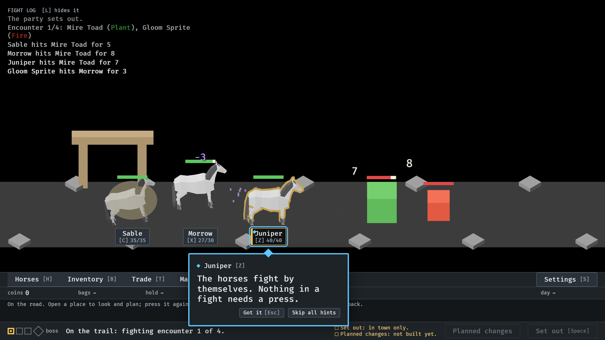
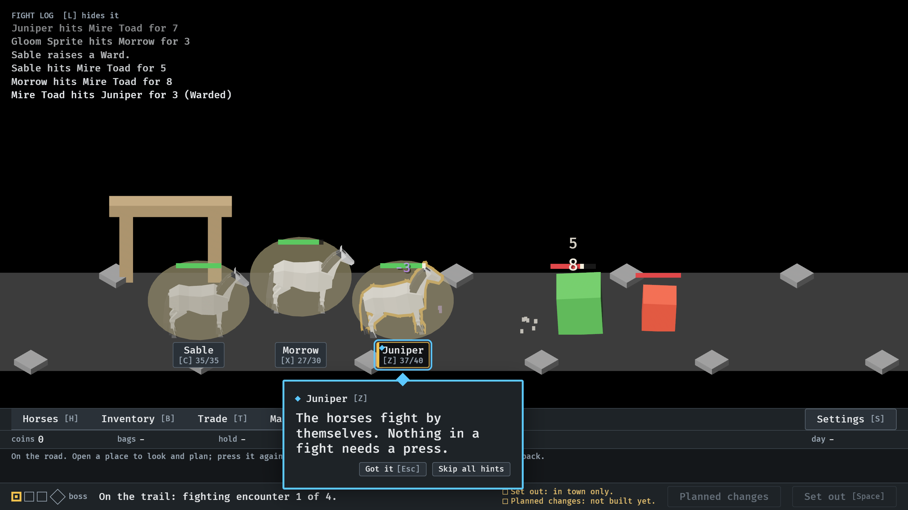
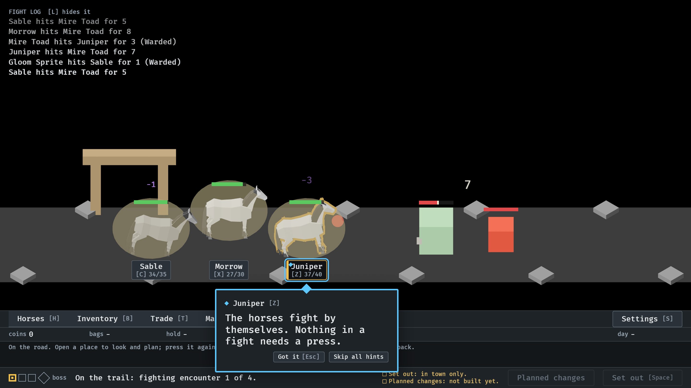
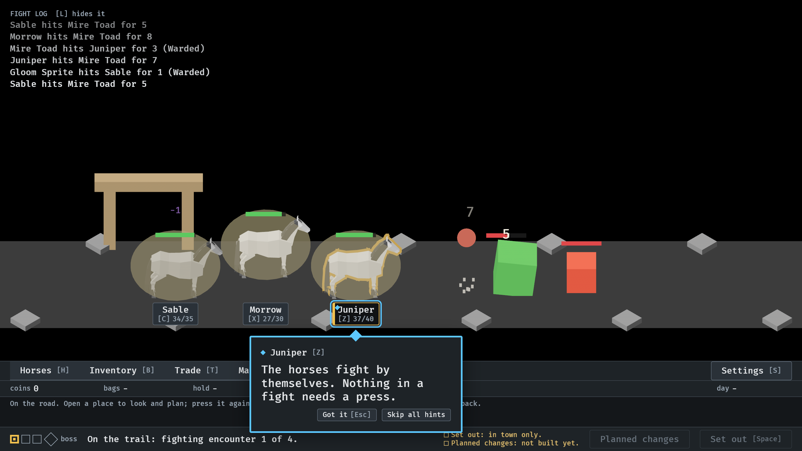
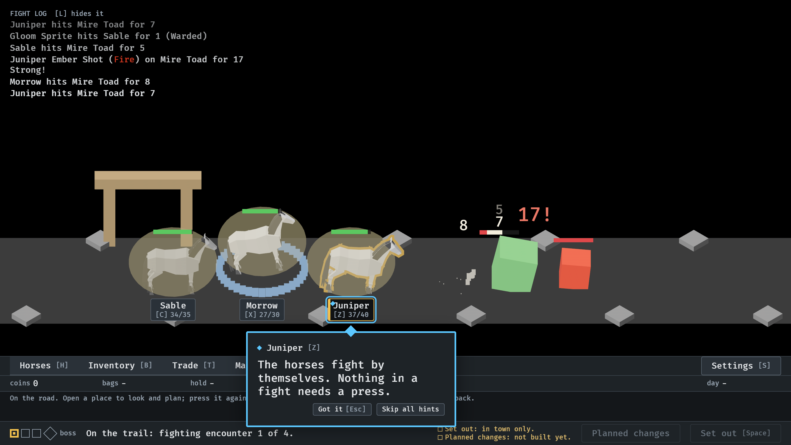
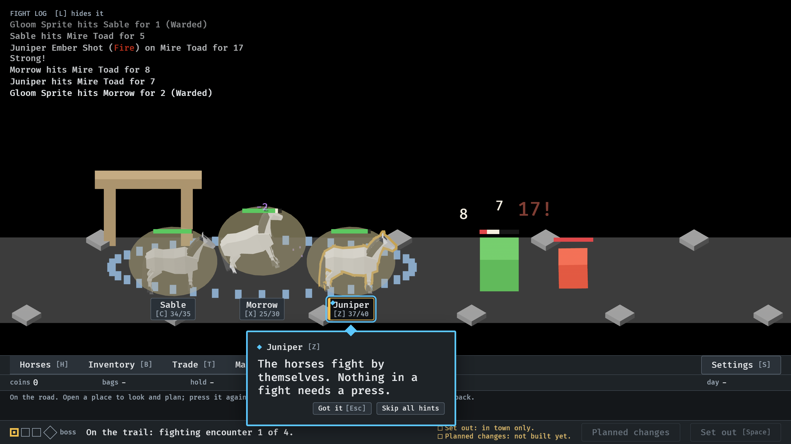
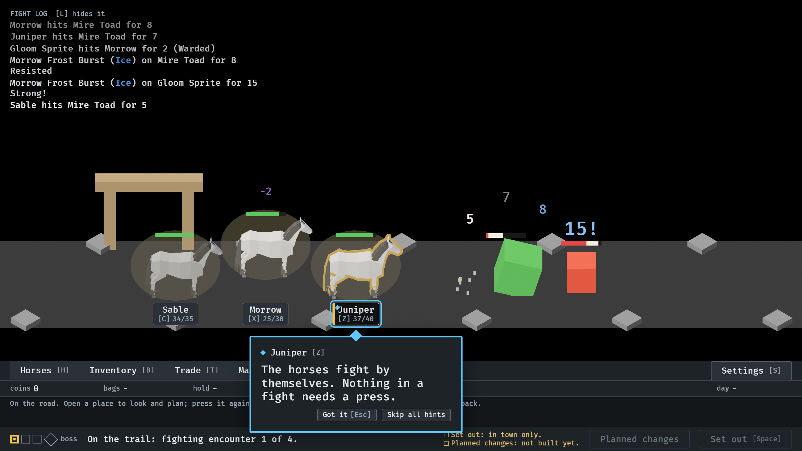

# Ability tells (#18)

`--seed 6 --no-pause`. Sable has the Ward, Juniper Ember Shot, Morrow
Frost Burst.

**1.** At 5.85 s: Sable rears as a pale glow swells round it; the Ward is raised at 6.0.

**2.** At 7.0 s: a bubble over every horse while the Ward lasts; hits on them are Warded.

**3.** At 7.8 s: an orb of Fire grows in front of Juniper as it draws back.

**4.** At 8.03 s: the orb in flight, arcing to the Mire Toad; it lands with the 17!.

**5.** At 8.7 s: a ring of ice shards closed in round Morrow, which rears.

**6.** At 9.07 s: the ring rushing out along the trail toward both enemies.

**7.** At 9.5 s: in its last second the bubbles flicker faint; by 10.35 they have popped and gone.

Pictures 3 to 5 were taken with the orb at 0.55 across (now 0.7); picture 6 after the ring was kept on the trail.
