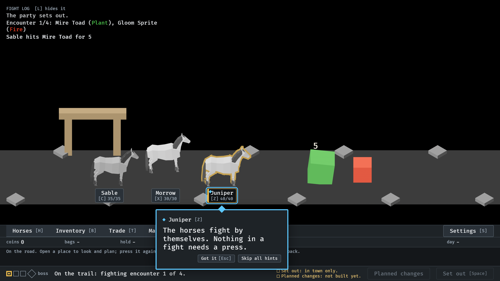
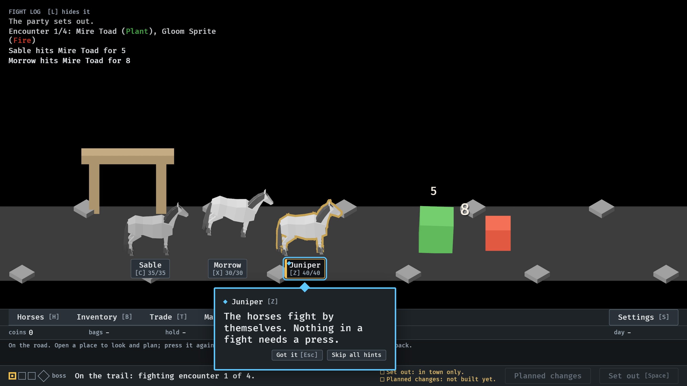

# Attack phases (#15)

`--seed 6 --no-pause`.

**1.** At 5.0 s: Morrow, in the middle, leans back, winding up. Sable is settling from its 5 on the toad, which is still tipped from it.

**2.** At 5.25 s: Morrow is furthest forward on the step its 8 lands on the toad. The swing is wound up ahead of the hit, not started by it.
