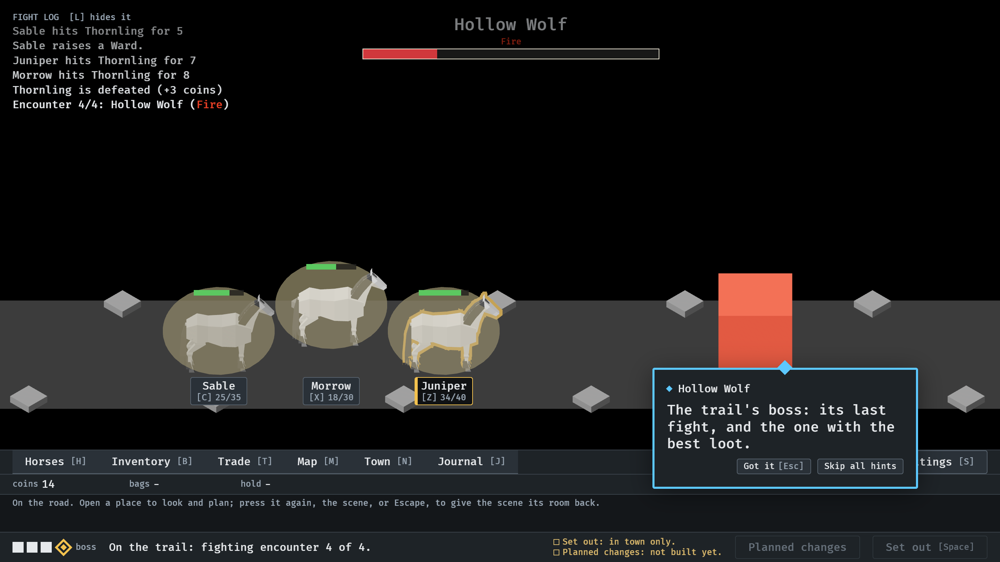
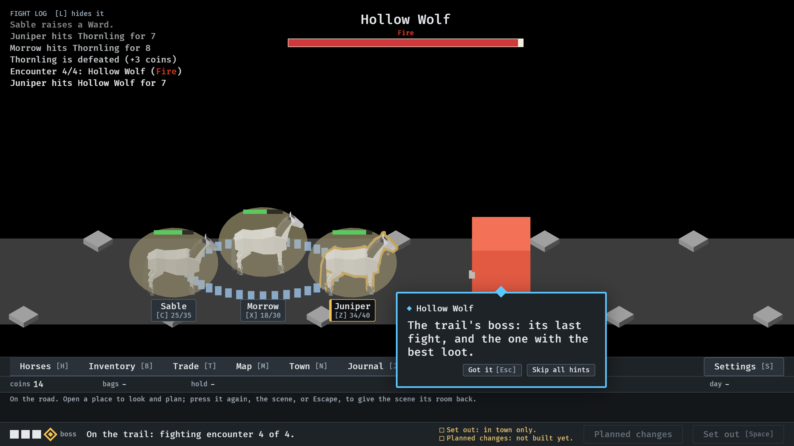
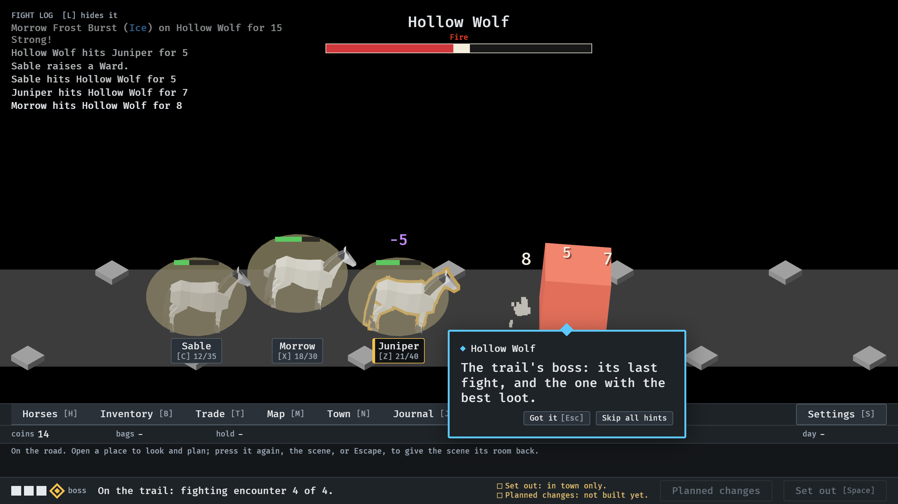
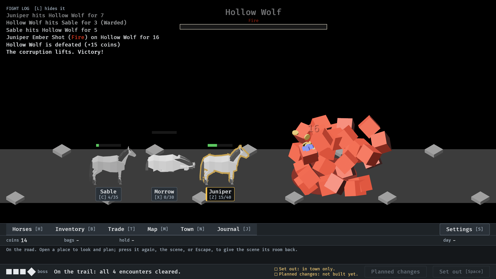

# The final enemy, announced (#19)

`--seed 6 --no-pause`.

**1.** At 35 s: the last encounter has opened and nothing has struck yet. The Hollow Wolf is still coming up the trail into its place; over the scene its name is fading in, with its element, and its bar is filling as it comes. The boss's lesson follows it.

**2.** At 37 s: it is in its place and the fight is on. Juniper's 7 is the first blow; its bar shows the sliver.

**3.** At 44 s: the bar is half gone, its trailing piece showing the last hits. There is no small bar over its head; this is its bar.

**4.** At 54.4 s: the kill. The emptied bar and the fading name stay a moment over its death.
