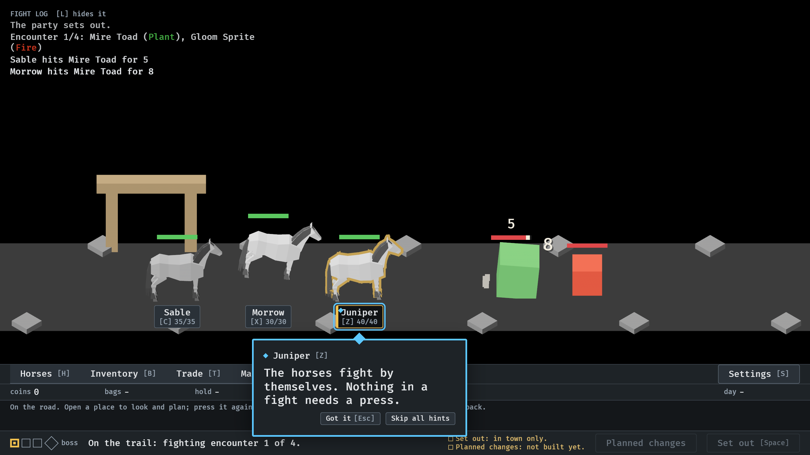
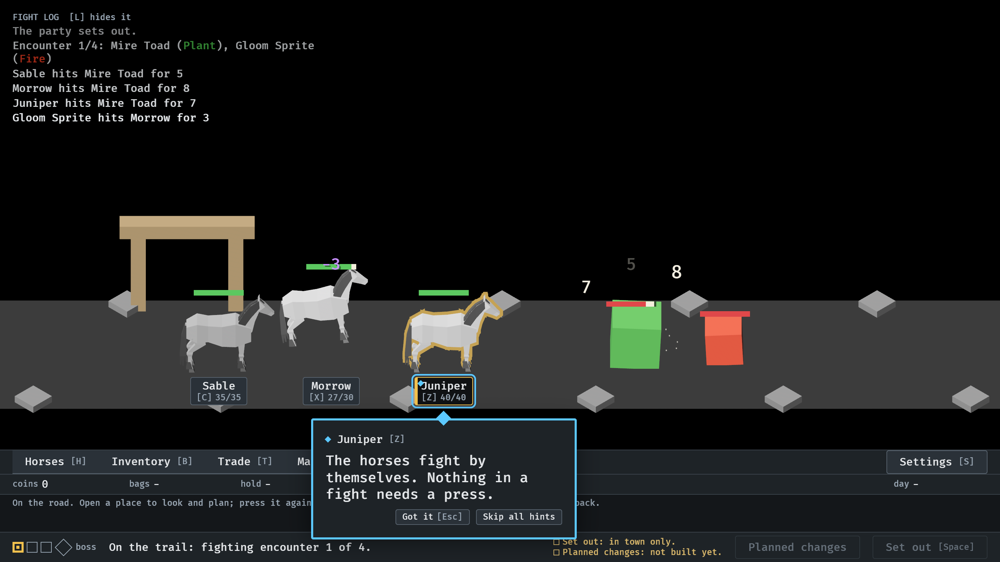
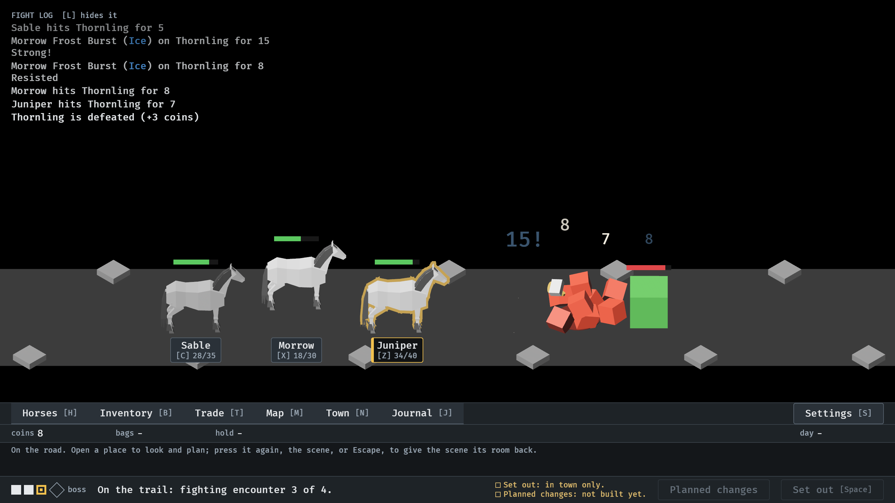

# Hit reactions (#16)

`--seed 6 --no-pause`.

**1.** At 5.27 s: Morrow's 8 has just landed on the Mire Toad. Its sparks spray off the toad's left face, and the toad's bar has dropped, with a light trailing piece where its health was.

**2.** At 5.75 s: the Gloom Sprite's 3 on Morrow. Morrow's bar drops at once and trails; the toad's trail has caught up.

**3.** At 28.05 s: a Strong Frost Burst (15!) and a resisted one (8) on two enemies. A strong hit throws more sparks, bigger, and recoils further than a resisted one.
