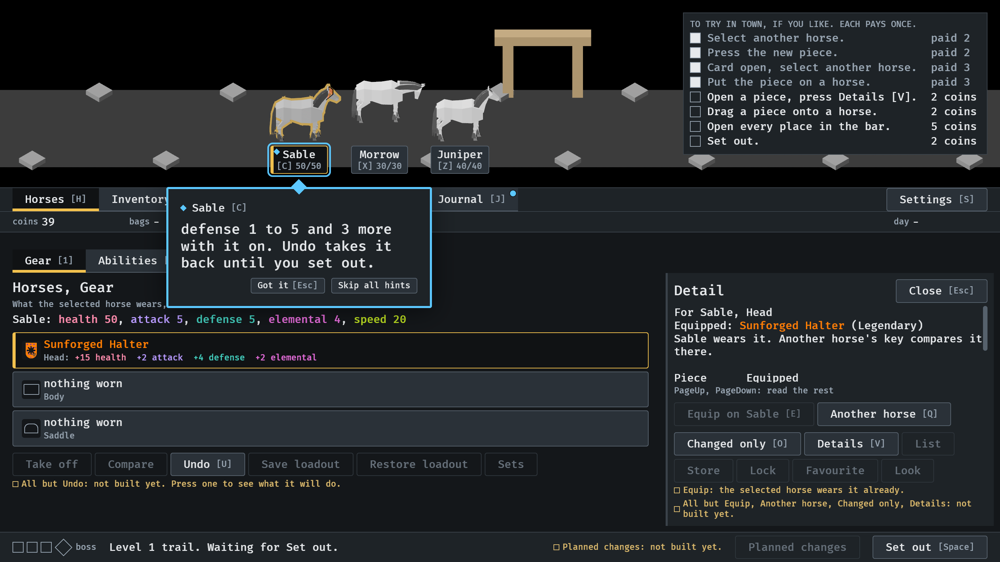
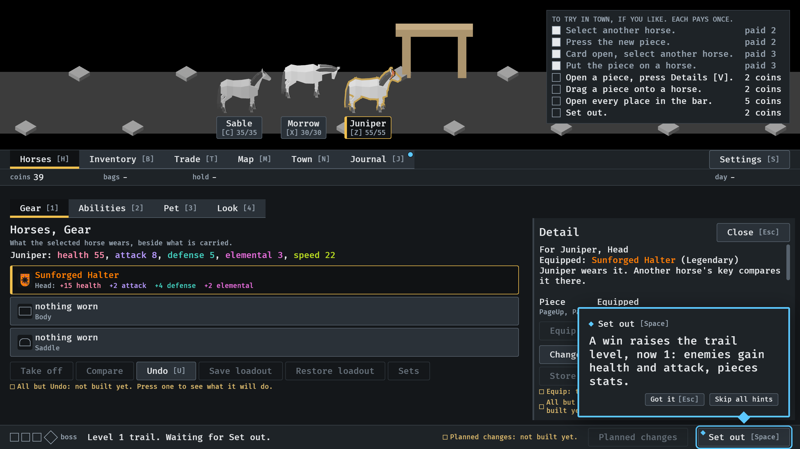
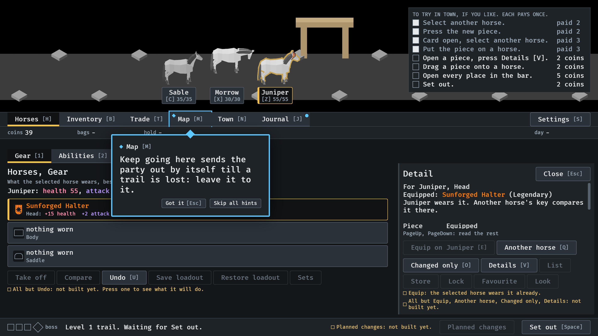

# 2026-10-16, the next trail, explained honestly (#298)

The lesson walk, `IDLE_LESSON` with `--seed 6`, pictures 04, 07 and 08.

1.  After Equip, on the horse the piece went on:
   "defense 1 to 5 and 3 more with it on. Undo takes it back until you set
   out." The stat that moved the most, as it was and as it is.
2.  After the first win, on Set out beside the footer's
   "Level 1 trail.": "A win raises the trail level, now 1: enemies gain
   health and attack, pieces stats."
3.  The exit line, on the Map: "Keep going here sends
   the party out by itself till a trail is lost: leave it to it."
