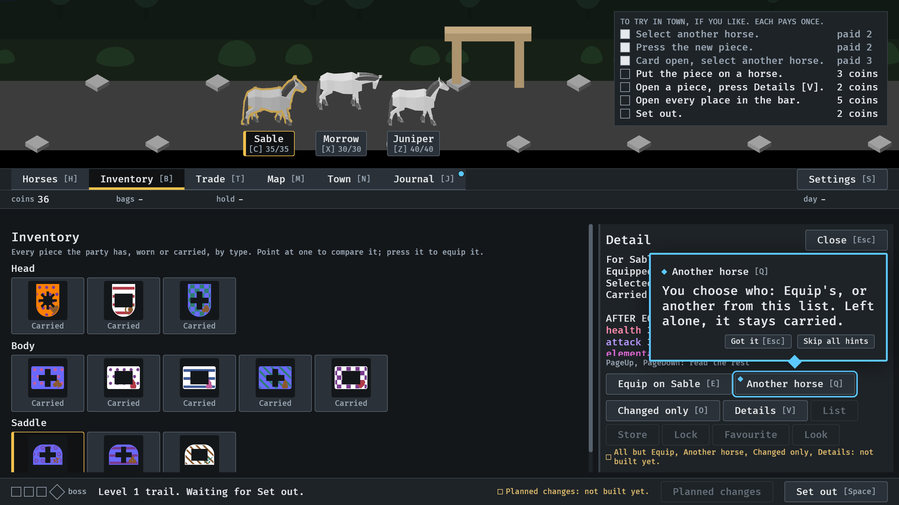
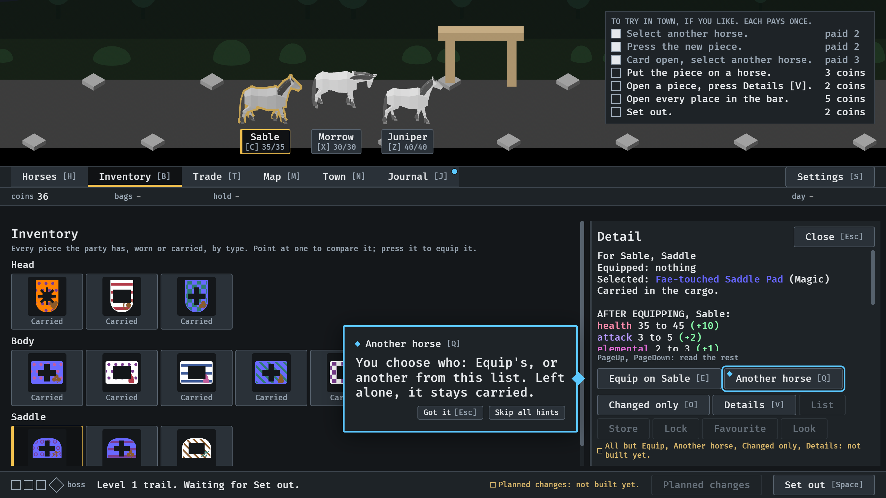

# Beside the card, 2026-10-17

#353, the owner's ruling of 2026-10-17: a lesson about a control on the item
card stands beside the card, not over it. From the lesson walk
(`IDLE_LESSON`, `--seed 6`), read by the session; the owner has not looked.

