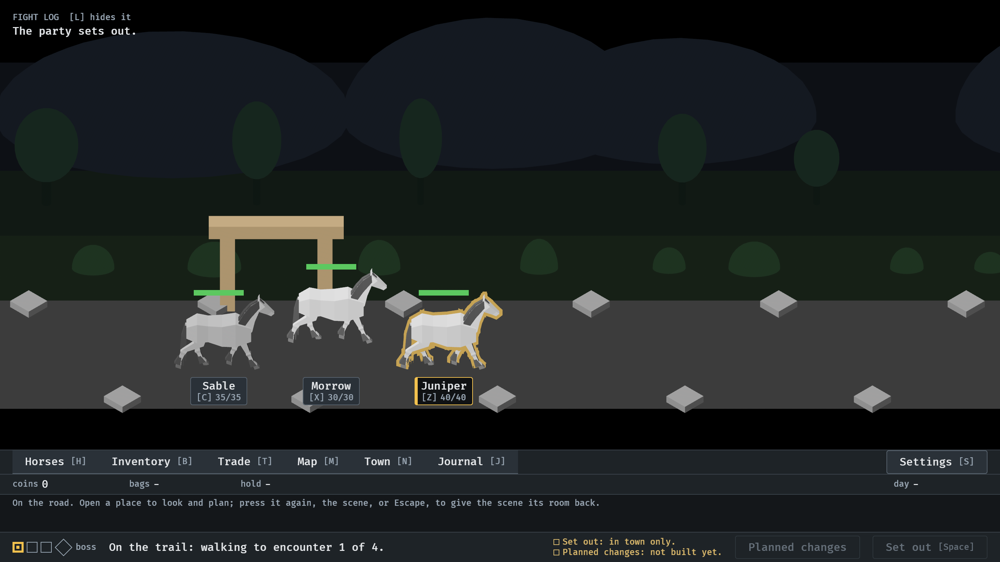
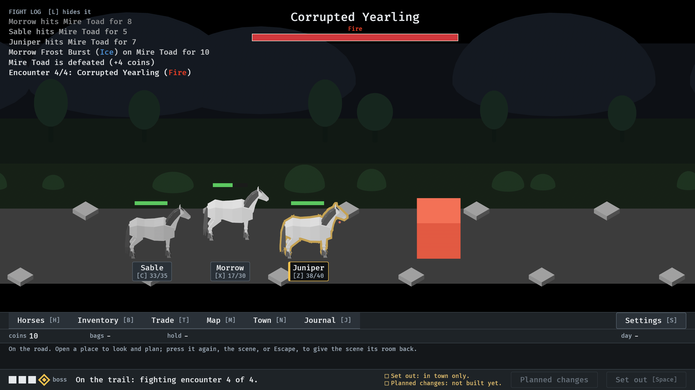
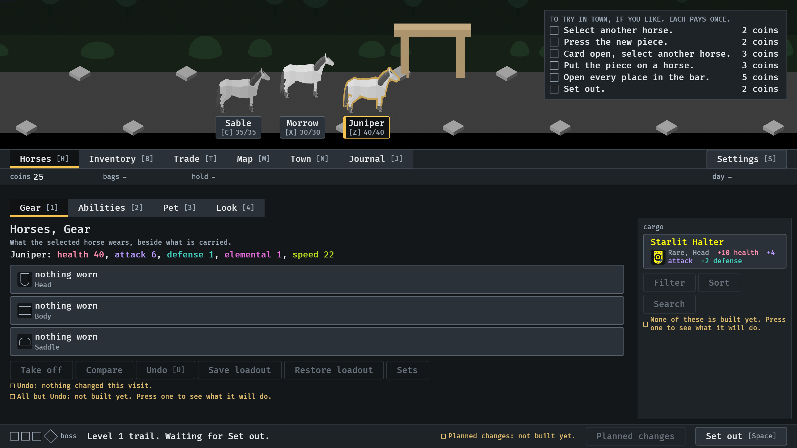

# 2026-10-19, release 0.2.5

From the staged 0.2.5 build, run from another folder, `--seed 6 --mute`.
Each timed picture answers the lessons with Got it, so none is up.

At 3 s: a new game starts on the road, out of the gate (#292), with the
parallax layers behind the trail (#254).

At 33 s: the first trail's own boss, the Corrupted Yearling (#294),
announced over its bar (#19).

At 70 s: home from the first trail with its fixed Rare Starlit Halter
(#294), and the things to try in town.
